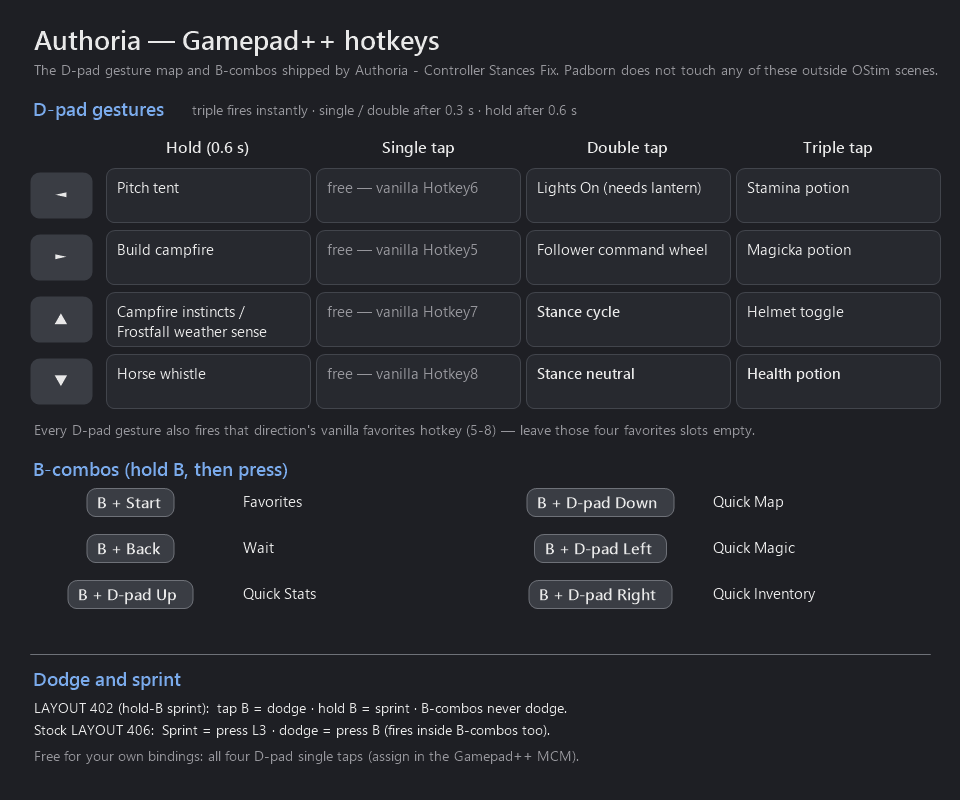

# Authoria — Padborn 3.2.0

**The complete controller package for the Authoria modlist.** One install, two halves:

**Half 1 — the Gamepad++ fixes (loose files, no plugin):**

1. **Menus are navigable with D-pad bindings live** — fixes an upstream Gamepad++ bug, so gestures
   no longer fire while you are in **conversation**, inventory, barter, the map or any other menu.
2. **D-pad stance switching restored** — double-tap Up cycles stances, double-tap Down goes neutral,
   the gesture base Authoria shipped and then removed.
3. **The QuickLoot window no longer fires gestures** — scrolling loot with D-pad Up/Down stopped
   injecting stance changes and potions.
4. **A full 16-slot D-pad gesture map** — potions, tent, campfire, helmet toggle, horse whistle,
   follower wheel, all on the D-pad.
5. **A dodge key that actually applies** — Authoria configures TK Dodge on B, but a UTF-8 BOM in the
   list's ini silently breaks it, so saves run the addon's factory default instead. Every layout
   option fixes that; the hold-B option additionally makes B-combos dodge-free.

**Half 2 — the Padborn SKSE plugin (`Padborn.dll`, no ESP):**

6. **OStim controller layer** — while an OStim player scene runs, every gamepad button is translated
   to the key OStim actually listens on (read live from OStim's MCM), and every other pad-reading mod
   (Wheeler, TK Dodge, TDM lock-on, Gamepad++…) is locked out of the pad for the duration. All 16
   buttons work; B held 0.6 s ends the scene. Outside a scene it touches nothing. **No OStim? No
   problem** — with no `OStim.esp` in the load order the layer stays dormant.
7. **Glyph bar** — a slim translucent bar for the whole scene showing which button does what, in
   your controller's own art style (Xbox letters or PlayStation shapes, auto-detected).
8. **Optional sprint-button move + experimental sprint rescue** — see "The Padborn plugin" below.
9. **First-person block (3.1.0)** — the game can no longer switch you to first person: not a script
   (81 loose scripts on the list call `Game.ForceFirstPerson()`, First Person Interactions after
   every lever pull among them), not the POV control, not a save restore. Your own zoom-in (mouse
   wheel) still gets you there (3.2.0). On by default,
   one json switch. Pairs with the layout change below that takes the vanilla POV toggle off R3, so
   TDM's lock-on no longer drags the camera into first person.

**Your choice of layout** — the installer asks which sprint placement you play: CCS LAYOUT 402
controlmaps (hold-B sprint, combo-safe) or Authoria's stock LAYOUT 406 with nothing moved. A
json switch can also move sprint to B with no controlmap files at all.

No plugin (.esp). Loose files + one SKSE DLL. Everything is reversible by disabling the mod.

⚠️ **This supersedes `Authoria - Controller Stances Fix` and the standalone `OPad` / `PadbornSprint`
DLLs.** If you have any of them installed, remove them first — see "Upgrading" below.
---

## Background — why base Authoria has no D-pad stance switching

Base Authoria shipped a custom Gamepad++ keyhandler (v2.7) with D-pad Up/Down double-tap bound to
Stances NG. It also shipped a controller bug: **menus were impossible to navigate.** The published
fix in `#known-issues-and-fixes` was to hide two files in *Authoria - Controller Configs*:

```
\SKSE\Plugins\StancesNG.toml
\Scripts\gpp_keyhandler.pex
```

That fix works, but it takes the stance gesture with it. The gesture wasn't broken on its own
merits — it was collateral. The documented replacement (rotate stances with the X button) is
acknowledged by list staff as intermittent.

### The actual bug — it is upstream in Gamepad++, not Authoria's doing

`gpp_keyhandler`'s menu guard reads:

```papyrus
Event OnMenuOpen(string MenuName)
    if !MenuName == "FavoritesMenu"     ; parses as (!MenuName) == "FavoritesMenu"
        GotoState("DISABLED")
    endif
EndEvent
```

`!MenuName` casts the String to Bool (non-empty = true) and negates it, giving `false`. Comparing
`false` to a non-empty string is always `false`, **so `GotoState("DISABLED")` never runs and
Gamepad++ never suppresses itself in menus.** The whole menu-suppression mechanism is dead code.

This is present in stock Gamepad++, in Complete Controller Setup's repack, and in the list author's
v2.7 alike. Once D-pad Up/Down carry bindings — which are exactly the menu scroll directions —
every fast scroll injects a keypress and blocks input for the multi-tap window. Stock Gamepad++
survives only because it binds Left/Right, which lists rarely scroll with.

The fix is one pair of parentheses:

```papyrus
if !(MenuName == "FavoritesMenu")
```

Favorites stays exempt on purpose, so the D-pad favorites hotkeys still work inside it.

### Second bug — the QuickLoot guard names a window that no longer exists

Gamepad++ ships a separate guard so gestures don't fire while the loot window is open. It checks
menu `"Loot Menu"` and `_root.Menu_mc._visible` — the **old QuickLoot RE** window. Authoria runs
**QuickLoot IE 3.4.0.0**, whose menu is `"LootMenu"` (no space, root `_root.lootMenu`). The strings
`"Loot Menu"` and `"_root.Menu_mc"` appear zero times in the live DLL, so the guard never matched.

Why Gamepad++ hears the button at all: QuickLoot IE suppresses the vanilla **user events** for the
D-pad while its window is up, but Gamepad++ doesn't use user events — it uses SKSE `RegisterForKey`
on raw button codes, upstream of the controlmap. QuickLoot eats the vanilla action, Gamepad++ still
gets the press.

Fixed here with a helper that checks the live name and keeps the legacy path as a fallback:

```papyrus
bool Function isLootWindowOpen()
    if ui.IsMenuOpen("LootMenu")
        return true
    endif
    return ui.IsMenuOpen("Loot Menu") && ui.GetBool("Loot Menu", "_root.Menu_mc._visible")
EndFunction
```

Scoped to **D-pad Up/Down only** (codes 266/267 — the scroll directions), matching upstream's
intent. Left/Right gestures stay live over the loot window.


---

## Install

1. Drag the archive into MO2 — the FOMOD installer opens and asks **two questions**: which
   **controller layout / sprint placement**, and whether to enable the **experimental sprint
   rescue** (leave it Off unless your sprint presses get eaten). Enable the installed mod. That's
   the whole install.
2. **Leave it where MO2 puts it** — the bottom of the left pane, which is the highest priority and
   therefore wins its file conflicts. Your own added mods don't change this: left-pane priority
   only matters between mods that ship the **same file**, and this mod ships no plugin, so the
   right-pane load order and whatever plugins you've added are untouched entirely.

   The one rule that must hold on *any* load order: this mod stays **below** (= higher priority
   than) the mods that ship the same files —
   `Gamepad Plus Plus` · `Complete Controller Setup` · `Authoria - Controller Configs` ·
   `Stances NG` · `Authoria - MCM and INI Settings` · `TK Dodge RE Addon` ·
   `TK Dodge RE - Script Free` · `Tk Dodge RE Addon - Requiem Perk Lock`.
   All of those are list mods near the top, so a fresh install at the bottom already satisfies it.
   Position relative to everything else is irrelevant.

   Ten-second check: right-click the mod → *Information* → *Conflicts* — it should **lose no
   files**. If you later install another mod that touches controlmaps or TK Dodge configs, it will
   land below this one and win; that same tab is where you'd catch it.
3. Leave the two `.mohidden` files in *Authoria - Controller Configs* hidden. This mod overrides
   from above; nothing needs un-hiding.
4. Load the game — no MCM steps on any option, new save or existing. If you picked the LAYOUT 402
   controlmaps: the **Complete Controller Setup MCM**'s layout picture should now read **402**, not
   406 — that confirms the whole mod is winning. On the stock-layout option the MCM picture stays 406
   (correct — they ship no controlmaps to win).

**Save-safe.** The script changes are code-only — no new properties or variables — so an existing
save loads clean. The DLL carries no ESP and no scripts at all, so it is safe to add or remove
mid-save. **Switching layouts later:** right-click the mod → *Reinstall Mod* — the same dialog
reruns, pick another option. Save-safe, zero setup; settings re-apply on the next load.

Requirements: SKSE64, Address Library for SKSE Plugins, Skyrim SE/AE 1.5.97+ (the DLL is built
runtime-independent; tested on 1.6.1170). The Gamepad++ half additionally needs Gamepad++ itself,
which the list already ships.

### Upgrading from the separate mods

- **`Authoria - Controller Stances Fix`** — remove it. Every file it shipped is in here, same
  contents; leaving both installed just makes a conflict you have to referee.
- **`OPad.dll` / `PadbornSprint.dll`** — remove BOTH. `Padborn.dll` replaces the pair; leaving one
  behind means a doubled input sink. An existing `OPad.json` keeps working — `Padborn.json` is just
  its new name.

### Choose your layout

Everything in `Core` is layout-independent — the gesture map, the stance keys, the guard fixes and
the whole DLL inject or read keys and don't care where sprint sits. The **dodge setup** is what
differs, so each option carries its own dodge files:

**Option 1 — LAYOUT 402 controlmaps, hold-B sprint (recommended; what this fix was built and
play-tested on).** Authoria installs CCS with fixed FOMOD answers (`A` activate · `Tween` menu ·
`Triggers` attack · `PRESS LS = SPRINT` · Wheeler v1), which CCS calls **LAYOUT 406**. The same
answers with `HOLD B = SPRINT` are CCS's **LAYOUT 402**. This option installs the CCS author's own
text + **binary** controlmaps for 402, plus its MCM pictures and `Layout 402.jpg`. Three rows
differ from 406 by the CCS author's design for the B variant, and 3.1.0 adds a fourth of its own:

| Action | LAYOUT 406 (Authoria stock) | LAYOUT 402 (this option) |
|---|---|---|
| **Sprint** | press L3 | **hold B** |
| **Sneak** | A + L3 | **bare L3 click** |
| **Auto-Move** | L3 + R3 | **B + L3** |
| **Toggle POV** | R3 | **off the pad** (keyboard F only) — 3.1.0, in BOTH the text and the binary controlmap |

Why Toggle POV moved: True Directional Movement's lock-on shares R3, and the engine reads the binary
`ControlMap_Custom.txt` on top of the text one, so R3 fired lock-on AND the vanilla POV toggle on
the same press — target lock = first person. With POV off the pad, R3 is lock-on only (TDM ini:
`bTargetLockUsePOVSwitchGamepad = 0`, `uTargetLockKey = 273`). The first-person block in the DLL
is the belt to these braces.

Dodge: **tap B = dodge, hold B = sprint** — the press path is unbound and the dodge rides TK
Dodge's sprint-key path, so the six B-combos can never fire a dodge. Details in "The dodge half".

⚠️ Padborn's own runtime sprint swap stays **off** here (`"button": "keep"`, the default). The
controlmaps already put Sprint on B; doing it twice would displace the wrong event.

**Option 2 — keep Authoria's LAYOUT 406; dodge on B, as authored.**
Installs **no controlmaps** and moves nothing — CCS's stock files keep winning and every button
stays where the list shipped it. Dodge stays on **press B with `iDodgeKey = 277`, exactly as the
list author configured it.** The catch this option fixes: the author's own `TKDodgeAddon.ini` starts
with a UTF-8 BOM that breaks MCM Helper's parse of `[General]`, so saves have been running the
addon's factory default key instead of the authored 277. Two files fix it for good: that ini **with
the BOM stripped** (byte-identical otherwise), and a patched MCM script whose `LoadSettings()`
re-applies `277` + sprint-dodge-off on **every game load** — so new *and* existing saves get the
authored key with zero setup. No `TK Dodge RE.ini` override: the list's own file keeps winning, so
in-place dodging and every other authored value stay untouched.

Authored quirks kept with it, so you know what you're choosing: pressing B while moving dodges —
**including inside the six B-combos** (Favorites, Wait, Quick menus; ~10 stamina each), and the
press path bypasses the Requiem dodge-perk gate. That is the behavior as designed; option 1 exists
for anyone who wants the combos dodge-free.

Consequence of the patched script (shared by both options): the MCM's **Dodge Key** and
**Sprint key dodge** controls are inert — every load re-pins the authored values. Want the MCM
controls back? Delete `Scripts\StyyTKDodgeMCM.pex` from this mod.

⚠️ **If you reinstalled CCS with your own FOMOD answers** (you're on neither 406 nor 402): pick
option 2 — it works on any layout since it touches no controlmaps.

⚠️ **CCS ships a *binary* `ControlMap_Custom.txt` at the Data root**, and the engine prefers it over
any text `controlmap.txt` row it covers. Hand-editing the text controlmap to move Sprint does
**nothing** — the binary must change too. This cost a week of confusion; don't repeat it.

If you want hold-B sprint but cannot use option 1's controlmaps, there is a third route that is
not in the installer: take option 2 and set `"sprint": { "button": "b" }` in
`SKSE\Plugins\Padborn.json`. The DLL then swaps the gamepad Sprint mapping in memory at game load
— the event that held B takes Sprint's old button — so no controlmap file is touched at all. Dodge
stays on the press path either way. The json also accepts `"lb"` and `"ls"`.

---

## The gesture map

Gamepad++ does not bind mod actions — it **synthesises a keyboard keypress**. So a mod is reachable
only if it listens on a single bare key with no modifier.

Design rule: **holds = survival · triples = combat + utility · doubles = toggles.** Triples are the
*fastest* gesture (they fire instantly on the third press); singles/doubles wait 0.3 s and holds
0.6 s — which is why potions sit on triples.

One-glance version of the whole layout — `gamepad-hotkeys.png` in this folder:



| Gesture | Sends | Action | Needs |
|---|---|---|---|
| Left **hold** | `27` `]` | Pitch tent | tent_pitcher |
| Left single | — | *free* — vanilla Hotkey6 | |
| Left **double** | `38` `L` | Lights On | Lights On (**and a lantern in inventory**) |
| Left **triple** | `12` `-` | Stamina potion | Optimal Potion Hotkey |
| Right **hold** | `43` `\` | Build campfire | Campfire |
| Right single | — | *free* — vanilla Hotkey5 | |
| Right **double** | `35` `H` | Follower command wheel | Swiftly Order Squad |
| Right **triple** | `13` `=` | Magicka potion | Optimal Potion Hotkey |
| Up **hold** | `70` ScrollLock | Campfire instincts / harvest wood / create item; Frostfall weather sense | Campfire, Frostfall |
| Up single | — | *free* — vanilla Hotkey7 | |
| Up **double** | `45` `x` | **Stance cycle** | Stances NG |
| Up **triple** | `21` `Y` | Helmet toggle | Helmet Toggle 2 |
| Down **hold** | `48` `B` | Horse whistle | Horse Whistle Key |
| Down single | — | *free* — vanilla Hotkey8 | |
| Down **double** | `52` `.` | **Stance neutral** | Stances NG |
| Down **triple** | `11` `0` | **Health potion** | Optimal Potion Hotkey |

Cycling reaches every stance (`bUseCycling = true`): repeated Up double-taps step Bear → Wolf →
Hawk, Down double-tap returns to neutral. Bear (`shift+x`) and Hawk (`ctrl+x`) aren't directly
reachable — Gamepad++ can't hold a modifier — but nothing is locked out.

**Only `StancesNG.toml`'s neutral key is changed** (`alt+v` → `.`), because `alt+v` is a modifier
combo Gamepad++ physically cannot send. Wolf stays on bare `x`, deliberately: the GameplayGuide's
documented "rotate stances with X" route *is* the wolf key acting as a cycle, and moving it would
break that. Nothing else on the list uses bare `x` or `.`.

### Verify your potion keys

Slots `[3] [7] [15]` assume `-` / `=` / `0`. Those come from the list's
`OptimalPotionHotkeyMCM.ini`, which is only a **preset** — the live values are stored in your save.
Check the Optimal Potion Hotkey MCM actually reads `0`, `-`, `=`, or the three potion gestures do
nothing.

### Known side effects, by design

- **Every D-pad gesture also fires vanilla favorites Hotkey5–8** for that direction. An SKSE key
  registration does not consume the press, so a hold costs one such fire and a double-tap two. This
  is already true of stock Gamepad++'s bindings. **Leave favorites hotkey slots 5–8 empty** and use
  the Favorites menu or Wheeler.
- **While the QuickLoot window is on screen, the four Up/Down gestures are inert** — including
  health potion (Down triple) and both stance gestures. `QLIE_ShowInCombat` is true by default, so a
  corpse in your crosshair mid-fight suppresses the health-potion gesture. Levers: turn
  *Show In Combat* off in the QuickLoot IE MCM, or move health onto a Left/Right triple. Fast
  scrolling *is* a triple-tap, so triples on Up/Down can't be exempted.
- **Wheeler is still exposed.** Its wheel is an ImGui overlay drawn through the D3D hook, not a
  registered game menu, so no Papyrus guard can see it — D-pad presses that move wheel entries also
  feed Gamepad++ gestures. Not observed as a problem in play; fixing it would need a native hook.
- **Bow Rapid Combo claims all four D-pad directions** for its idle-stop. Watch for interaction
  while a bow is drawn.

### ⚠️ First load resets some Gamepad++ bindings — once

The script reports version **3.5** where stock reports 2.5, so `checkVersion()` fires once on the
next load and writes the 16 bindings above. In the same pass it also **resets Combo Key 1 to A,
unsets Combo Keys 2–4, and forces multi-tap and long-press on.** Custom Gamepad++ bindings you set
in the MCM for those slots are gone and need re-entering. This is the same reset the list author's
own build performed.

Also: don't bump `getVersion()` if you patch this script yourself — a bump re-triggers that wipe.

---

## The dodge half

B is the modifier for **six** combos: `B+Start` Favorites · `B+Back` Wait · `B+D-pad Right` Quick
Inventory · `B+D-pad Left` Quick Magic · `B+D-pad Up` Quick Stats · `B+D-pad Down` Quick Map. With
a press-path dodge on B, each one costs a dodge and ~10 stamina to open.

TK Dodge RE Addon has **two independent, additive dodge paths**:

| Path | Setting | Fires | Perk lock |
|---|---|---|---|
| Raw key | `iDodgeKey` | on **press**, no hold check | bypasses it |
| Sprint key | `bEnableSprintDodge` | on **release**, only if held < `SprintingPressDuration` | enforces it |

**Option 2 (stock 406)** keeps the authored press-path dodge on B — the author's `TKDodgeAddon.ini`
de-BOM'd so `iDodgeKey = 277` finally parses, plus a pinned MCM script that re-applies it every
load; everything below this line is **option 1 (LAYOUT 402) only.**

Option 1 unbinds the press path and runs on the release path: sprint is on B, a combo inherently
*holds* B, so combos can never dodge **by construction** rather than by timing luck.

| File (402 option) | Sets | Why |
|---|---|---|
| `MCM\Settings\TKDodgeAddon.ini` | `iDodgeKey = -1`, `bEnableSprintDodge = true`, `bUsePerkLock = true` — **no BOM, bools spelled out** | the user/modlist override layer |
| `MCM\Config\TKDodgeAddon\settings.ini` | same values | fresh MCM registrations read this layer too |
| `Scripts\StyyTKDodgeMCM.pex` | patched `LoadSettings()` hardcodes `DodgeKey = -1` and sprint-dodge ON, on every load | the guarantee — see below |
| `SKSE\Plugins\TK Dodge RE.ini` | `SprintingPressDuration = 0.25`, `EnableDodgeInPlace = false` | the hold gate, and no dodge when standing still |

**Two traps that make ini edits alone fail:**

1. **A UTF-8 BOM breaks MCM Helper's ini parse.** Every list-shipped `TKDodgeAddon.ini` starts with
   `EF BB BF`, which corrupts the first `[General]` section header — every key under it is silently
   ignored while later sections (`[Perk]`) parse fine. That is why every save on this list ran the
   addon's factory defaults (`iDodgeKey = 56`, keyboard Left Alt) no matter what the file said.
2. **MCM Helper bool reads from `[General]` deliver on no spelling here** — `1` and `true` both read
   false, while Ints parse correctly. That's why `bEnableSprintDodge` is pinned in the patched
   script instead of trusted to the ini.

Consequence of the patched script: the MCM's **Dodge Key** and **Sprint key dodge** controls are
**inert** — changing them does nothing, and every load re-pins the values. Tune behavior in
`TK Dodge RE.ini` instead, or delete `Scripts\StyyTKDodgeMCM.pex` from this mod to get the stock
MCM controls back. The other four MCM settings (stamina cost, MCO recovery, percentage cost, perk
lock) still work normally.

**No MCM steps, even on an existing save** — the script re-stamps on every game load. Both options
carry this guarantee (each pins its own values: `-1`/on for 402, `277`/off for 406).

### Dodge is perk-locked — intentional

Authoria integrates the Requiem Perk Lock addon. Dodging works only once your character has
**Dodge** (Evasion) or **Relentless Onslaught** (Heavy Armor). Before that, tap-B does nothing and
costs nothing. Not a bug.

### Tuning

- `SprintingPressDuration = 0.25` — undocumented setting, read out of the DLL, tuned not gospel.
  Sprint starts too slowly or dodge feels sluggish → lower it. Combos ever dodge → raise it.
- `EnableDodgeInPlace = false` — a **stationary** tap does nothing, which is what stops "close a
  menu with B" from dodging. Dodging needs a movement direction held. Prefer in-place dodges and
  accept the occasional menu-close dodge? Set it back to `true`.

### Verifying

Set `EnableDebugLog = true` in `TK Dodge RE.ini`, play a minute, then read
`Documents\My Games\Skyrim Special Edition\SKSE\TK_Dodge_RE.log`:

| Line | Means |
|---|---|
| `found SprintingPressDuration with value 0.25` | the ini is winning |
| `key lifted and was pressed less then SprintingPressDuration - dodging` | the sprint path fired — **the goal on option 1** |
| `key was pressed` | the press path fired — **wrong on option 1** (`iDodgeKey` got bound again), **the goal on option 2** |
| `actual perk exists but player doesn't have it` | perk gate working as intended (option 1; option 2's press path bypasses it) |

Set it back to `false` afterwards.
---

## The Padborn plugin (`SKSE\Plugins\Padborn.dll`)

One DLL, four things, none of them touching the Gamepad++ half:

**OStim controller layer.** The DLL hooks the input dispatch *upstream of every mod's event sink*,
so while an OStim **player** scene runs each gamepad button is rewritten in place to the keyboard
key OStim is currently bound to, and the original button is blanked — Wheeler, TK Dodge, TDM lock-on
and Gamepad++ all see nothing. Keyboard, mouse and thumbsticks are never touched, so the camera and
free cam keep working. Scene detection uses OStim's own plugin interface (thread start/stop), not
menu visibility. Default map: D-pad = navigate · A = yes · X = toggle · RT/LT = speed · RB = pull
out · LB = search · Y = alignment · Start = auto/manual · L3 = free cam · Back = hide UI ·
**B held 0.6 s = end scene** (hold-only on purpose — a stray tap must not end the scene).

**Glyph bar.** Drawn near the bottom of the screen for the whole scene, matching the connected pad's
art. The Back button (hide UI) hides the bar with the rest of the interface.

**Sprint rescue (EXPERIMENTAL, off by default).** Some mod combinations (seen with Classic Sprinting
Redone + TK Dodge RE Addon) eat the held frames of the sprint control, so a sprint press that lands
before you're at running speed is silently lost. Padborn can watch the sprint control and re-set the
sprint flag once the button has been held past 0.3 s (keyboard presses included). Confirmed on one
setup only, so it **ships disabled** — the installer's second question, or
`"sprint": { "enabled": true }` in the json.

**First-person block (3.1.0, ON by default).** The player camera can no longer enter the first-person
state, whoever asks. Four layers, all inside the DLL, nothing written to disk:

1. `PlayerCamera::ForceFirstPerson` — the engine function behind Papyrus `Game.ForceFirstPerson()`
   and most SKSE plugins — is detoured to a no-op.
2. `TESCamera::SetState` — a request for the player camera's first-person state is redirected to
   third person (dropped when already there). Catches zoom-in, load-game restores and anything
   that bypasses layer 1.
3. The vanilla **Toggle POV** control is swallowed (nothing to toggle to). Hold-to-rotate on that
   key goes with it; the right stick still rotates the camera.
4. A per-frame watchdog: camera found in first person anyway → `ForceThirdPerson` before the
   camera updates, and a line in `Padborn.log`.

Every blocked attempt is logged (`camera: ForceFirstPerson blocked (#n)` — first 20, then every
500th), so a script that keeps trying shows up by name of its count, not by surprise. Switch it
off with `"camera": { "blockFirstPerson": false }`; keep the block but let the keyboard POV key
work with `"allowManualToggle": true` (then only forced/automatic switches are blocked and the
watchdog stands down). Not built for VR.

**Zoom-in exception (3.2.0, ON by default).** Your own zoom-in (mouse wheel up, or whatever the
Zoom In control is bound to) may still take the camera into first person, and the watchdog
leaves it there until you zoom back out. Padborn watches for that press; a first-person request
that arrives within 0.75 s of it passes layers 1-2 and is logged as
`camera: zoom-in to first person allowed`. Scripts, the POV control and save restores are still
blocked. Turn it off with `"allowZoomIn": false` in the `camera` block.

### Config (`SKSE\Plugins\Padborn.json`)

Everything is optional; delete the file for built-in defaults. The `_comment` block in the json is
the full reference: first-person block, sprint on/off + diagnostics, sprint button, per-button OStim
bindings, hold timing, lockout behavior, and glyph-bar size/position/art style. Both installer
answers are just json values — flip them any time without reinstalling.

---

## What's in the box

FOMOD, three folders:

**`Core` — always installed, layout-independent:**

| File | What |
|---|---|
| `SKSE\Plugins\Padborn.dll` (+ `.pdb`) | the plugin: first-person block, OStim controller layer, glyph bar, sprint button move, sprint rescue |
| `Scripts\gpp_keyhandler.pex` | Gamepad++ v2.5 + menu guard fix + QuickLoot guard fix + the 16 bindings; reports version 3.5 |
| `Source\Scripts\gpp_keyhandler.psc` | its source — commented; one `ApplyAuthoriaBindings()` holds the whole map |
| `SKSE\Plugins\StancesNG.toml` | Stances NG's own file, **one line changed** (`sNeutralStanceKey` → `.`) |
| `gamepad-hotkeys.png` | the gesture card above |

**`SKSE\Plugins\Padborn.json`** is written by the installer from your sprint-rescue answer (two variants in
`Config\`), and is yours to edit afterwards.

**`Layout 402` — only with option 1:**

| File | What |
|---|---|
| `ControlMap_Custom.txt` + `Interface\controls\pc\controlmap.txt` | CCS **LAYOUT 402** — the author's own binary + text controlmaps, one change in each: Toggle POV's gamepad column 0x0080 (R3) → unbound |
| `Interface\controls\pc\BL.dds` + `CI.dds`, `Layout 402.jpg` | LAYOUT 402's MCM pictures and reference image, straight from the CCS archive |
| `MCM\Settings\TKDodgeAddon.ini` + `MCM\Config\TKDodgeAddon\settings.ini` | dodge key unbound, sprint-dodge on — no BOM, bools spelled out |
| `Scripts\StyyTKDodgeMCM.pex` (+ source in `Source\`) | patched MCM script pinning those two values every load |
| `SKSE\Plugins\TK Dodge RE.ini` | hold gate 0.25 s + no dodge in place, list's `[Perk]` block intact |

**`Layout 406` — only with option 2:**

| File | What |
|---|---|
| `MCM\Settings\TKDodgeAddon.ini` | the list's own file (`iDodgeKey = 277` = dodge on B, as authored) with the UTF-8 BOM stripped — byte-identical otherwise |
| `Scripts\StyyTKDodgeMCM.pex` (+ source in `Source\`) | pinned MCM script — re-applies `277` + sprint-dodge-off every load, so existing saves self-heal too |

## Rebuilding

**Scripts.** Both `.psc` files compile with the stock Creation Kit compiler. Properties and script variables in
`gpp_keyhandler` are byte-for-byte the stock 2.5 set — only functions changed — which is what keeps
it save-safe over a stock install. Imports:

- `gpp_keyhandler.psc`: SKSE sources (`Input`, `UI`, `SKSE`, `Game`), `ConsoleUtil.psc` from
  ConsoleUtilSSE NG, and the vanilla sources for `ReferenceAlias`.
- `StyyTKDodgeMCM.psc`: `MCM_ConfigBase` + `SKI_ConfigBase` / `SKI_ConfigManager` / `SKI_QuestBase`
  from MCM Helper and SkyUI, plus SKSE and vanilla sources. ⚠️ Use CLEAN SkyUI sources — the
  MCM-Recorder-patched `SKI_ConfigBase.psc` that some lists ship drags JContainers into the import
  graph and breaks the compile.

If you edit `gpp_keyhandler.psc`, leave `getVersion()` at 3.5 unless you *want* every recipient's
hold slots and combo keys reset again.

**The DLL.** C++ source for `Padborn.dll` ships in the archive under `Source\` (not installed):
`CMakeLists.txt` + `vcpkg.json` + `src\`, CommonLibSSE-NG (`extern\CommonLibSSE-NG`, alandtse
CommonLibVR branch `ng`), Microsoft Detours (vcpkg), CMake + vcpkg, MSVC x64 Release. Configure with
`-DCOMMONLIB_ENABLE_IPO=OFF` if cl.exe crashes in "Generating Code". The build ships a PDB.

## Reverting

Disable the mod folder. Everything returns to the list's published state, including the Discord fix,
which stays applied throughout — nothing here un-hides those two `.mohidden` files.

## After a modlist update

Updates hard-delete user-added mods and restore CCS to the list's own sprint choice. Keep this
archive **outside** the MO2 instance and reinstall afterwards.

---

## Changelog

**3.2.0 (2026-09-13)** — Padborn.dll 2.2.0: zoom-in exception for the first-person block.
Scrolling into first person works again; forced switches (scripts, POV control, restores) stay
blocked. New json key `camera.allowZoomIn` (default true). Source updated in `Source\`.

**3.1.0 (2026-09-08)** — Padborn.dll 2.1.0: first-person block (on by default, `camera` json block).
Layout 402 controlmaps: Toggle POV taken off the gamepad in the text AND the binary file (R3 was
firing TDM lock-on and the vanilla POV toggle together). Source updated in `Source\`.

**3.0.0** — Gamepad++ fixes + gesture map + dodge setup + Padborn.dll 2.0.0 (OStim layer, glyph bar,
sprint rescue) merged into one package.

## Status

- Gamepad++ menu + QuickLoot guard fixes, gesture map, dodge setup: confirmed in play.
- OStim lockout/translation layer: confirmed in play.
- Sprint rescue: works on the author's setup; experimental elsewhere, hence off by default.
- Glyph bar: freshly built, in-game pass pending.
- First-person block + POV off R3: built 2026-09-08, in-game pass pending.

---

*Built by digging through the live binaries, decompiles and logs on one Authoria install. The two
Gamepad++ bugs are upstream — anyone running Gamepad++ with D-pad bindings has them.*
